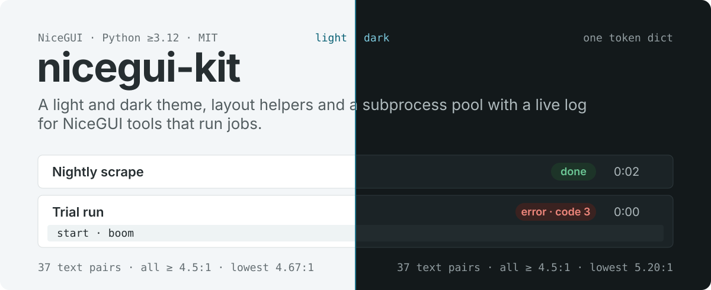
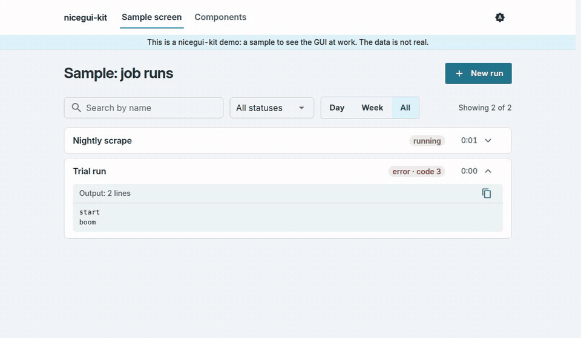
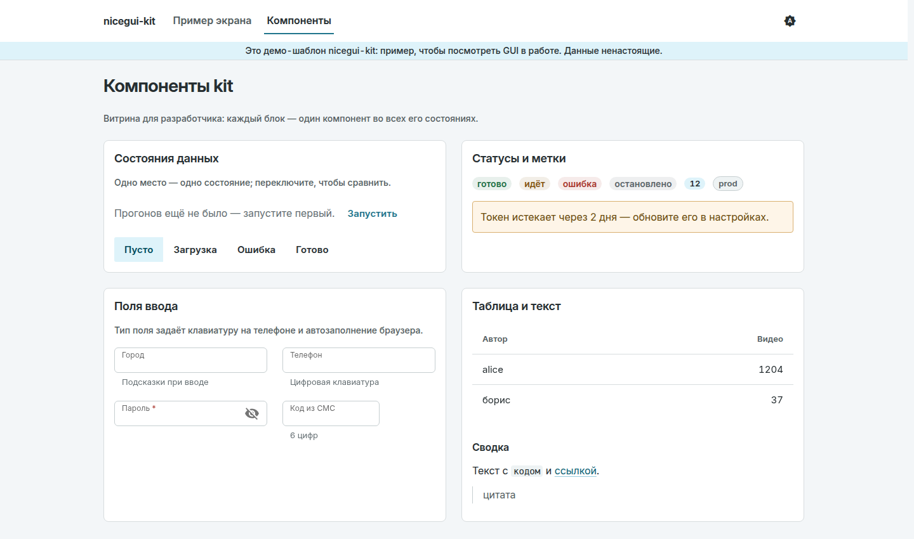
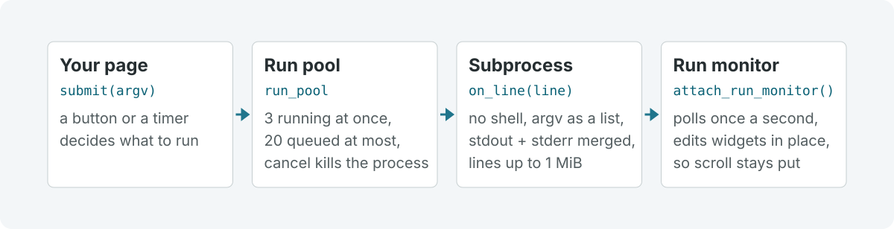

<p align="center">
  <picture>
    <source media="(max-width: 600px)" srcset="https://raw.githubusercontent.com/octrow/nicegui-kit/main/docs/images/hero-mobile.svg">
    
  </picture>
</p>

<p align="center">
  <a href="https://github.com/octrow/nicegui-kit/actions/workflows/ci.yml"></a>
  <a href="https://pypi.org/project/nicegui-kit/"></a>
  <a href="https://pypi.org/project/nicegui-kit/"></a>
  <a href="LICENSE"></a>
</p>

<p align="center"><b>English</b> | <a href="README.ru.md">Русский</a></p>

A WCAG AA theme, layout helpers and a live subprocess runner for [NiceGUI](https://nicegui.io) apps that run jobs.

Fits internal tools, scrapers, admin panels and review queues.

- `theme.apply_theme()`: light and dark themes, a self-hosted Inter font that works offline.
- `layout`: helpers that keep spacing consistent.
- `run_pool` and `run_monitor`: start a subprocess from a button, watch its log live, cancel it for real.



This screen is [`examples/showcase.py`](examples/showcase.py), about 200 lines on top of the kit.

## Install

```bash
pip install nicegui-kit
# or
uv add nicegui-kit
```

Python ≥3.12, `nicegui>=3.15,<4`.

## Quick start

```python
from nicegui import ui
from nicegui_kit import layout, run_pool, run_monitor, theme

theme.apply_theme()  # once, before ui.run() — colors/CSS shared across pages


@ui.page("/")
def index() -> None:
    with layout.page_container(max_width=layout.PAGE_MAX_WIDTH_WIDE):
        layout.heading("My tool", level=1)
        theme.theme_toggle()  # usually inside ui.header()
        with layout.section_card():
            layout.button("Run it", kind="primary", on_click=lambda: run_pool.submit(
                ["python", "-c", "print('hi')"], label="demo run",
            ))
        run_monitor.attach_run_monitor()


ui.run(host="127.0.0.1")
```

The full demo, from a clone:

```bash
git clone https://github.com/octrow/nicegui-kit && cd nicegui-kit
uv run python examples/showcase.py   # http://127.0.0.1:8787, ?dark=1 forces dark
```

Kit strings are Russian by default; `texts.TEXTS.update(texts.EN)` switches them to English, as the
showcase does.

## What's in the kit

| module | what you get |
|---|---|
| `theme` | `apply_theme()`: light and dark tokens in one dict, every text/background pair tested at WCAG AA in both themes, self-hosted Inter Variable. `theme_toggle()`: a header button that cycles system → light → dark and remembers the choice |
| `layout` | `page_container`, `heading`, `section_card`, `grid`, `field`, `filter_bar`, `button` and more (full list in the API reference). Three states every data view needs: `empty`, `waiting`, `failed` |
| `table` | `empty_aware_table()`: a `ui.table` and its "nothing found" label, kept in sync by one call |
| `hotkeys` | `on_keydown()`: page hotkeys that ignore keyup, held modifiers and typing in inputs |
| `texts` | every kit string in one dict, Russian by default, `texts.EN` for English |
| `run_pool` | `submit(argv)`: subprocesses with a slot limit, a queue cap and cancel; no `ui.*` inside |
| `run_monitor` | `attach_run_monitor()`: live list of runs with status, log and a cancel button |

The `/kit` page of the showcase shows each component in all its states:



Signatures and details for every module are in the [API reference](https://github.com/octrow/nicegui-kit/blob/main/docs/api.md). The design rules
behind the theme (tokens, type scale, do's and don'ts) are in [DESIGN.md](https://github.com/octrow/nicegui-kit/blob/main/DESIGN.md).

## How a run works

<picture>
  <source media="(max-width: 600px) and (prefers-color-scheme: dark)" srcset="https://raw.githubusercontent.com/octrow/nicegui-kit/main/docs/images/flow-mobile-dark.svg">
  <source media="(max-width: 600px)" srcset="https://raw.githubusercontent.com/octrow/nicegui-kit/main/docs/images/flow-mobile-light.svg">
  <source media="(prefers-color-scheme: dark)" srcset="https://raw.githubusercontent.com/octrow/nicegui-kit/main/docs/images/flow-dark.svg">
  
</picture>

Your page calls `run_pool.submit(argv)`. The pool runs up to 3 processes at once and queues up to 20 more.

`argv` is a list and never goes through a shell. stdout and stderr are merged. Lines up to 1 MiB are
kept, because asyncio's default 64 KiB limit would break the pipe.

The run monitor polls once a second and edits the existing widgets. NiceGUI has no virtual DOM, so a
rebuild would collapse open panels and reset the log's scroll position.

## Why not plain NiceGUI?

NiceGUI gives you Quasar components and Tailwind classes. That is enough for one page.

Across several tools the same problems come back:

- colors that fail contrast in dark mode;
- a different gap on every card;
- a subprocess launched from a button that blocks the event loop or leaves a zombie when the tab closes;
- a log view that jumps to the top on every refresh.

The kit fixes these once and tests them. You still write `ui.*` code, and each part works on its own.

For a data app built around dataframes and charts, Streamlit or Gradio may fit better.

## Out of scope

Domain logic stays in your app. The kit gives you the pieces to build it:

- Duplicate-run detection and "you are number N in the queue" wording: use `RunState.meta` and
  `run_pool.live_runs()`.
- Parsing a run's output for known error patterns: the failure summary is a plain "exit code N" line;
  read the log in `on_line` if you need more.

## Agent skill

`.claude/skills/nicegui-kit-gui/SKILL.md` teaches a coding agent to build GUIs on this kit (what to
mirror, the non-obvious NiceGUI traps). Claude Code picks it up by itself in sessions inside this repo;
install it to use it in your own projects:

```bash
# via the skills CLI (https://github.com/vercel-labs/skills); copies the skill, works with several agents
npx skills add octrow/nicegui-kit --skill nicegui-kit-gui -g -a claude-code   # global
npx skills add octrow/nicegui-kit --skill nicegui-kit-gui -a claude-code      # into ./.claude/skills of the current project
```

Refresh with `npx skills update nicegui-kit-gui`, remove with `npx skills remove nicegui-kit-gui`.

## Development

```bash
uv sync --extra dev
uv run pytest -q
```

The README images are built from the kit's own tokens: `uv run python docs/images/readme_svgs.py`.
Contributions are welcome, see [CONTRIBUTING.md](https://github.com/octrow/nicegui-kit/blob/main/CONTRIBUTING.md). Security issues: [SECURITY.md](https://github.com/octrow/nicegui-kit/blob/main/SECURITY.md).

## License

MIT, see [LICENSE](https://github.com/octrow/nicegui-kit/blob/main/LICENSE). The bundled Inter font is under the SIL Open Font License 1.1, see
[THIRD_PARTY_NOTICES.md](THIRD_PARTY_NOTICES.md).
