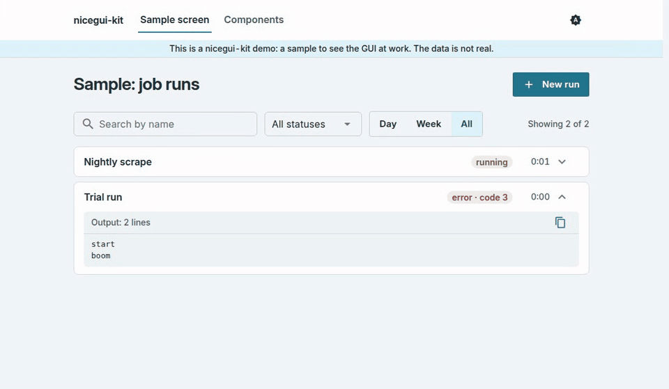

<p align="center">
  <picture>
    <source media="(max-width: 600px)" srcset="docs/images/hero-mobile.svg">
    
  </picture>
</p>

<p align="center">
  <a href="https://github.com/octrow/nicegui-kit/actions/workflows/ci.yml"></a>
  <a href="https://pypi.org/project/nicegui-kit/"></a>
  <a href="https://pypi.org/project/nicegui-kit/"></a>
  <a href="LICENSE"></a>
</p>

<p align="center"><a href="README.md">English</a> | <b>Русский</b></p>

nicegui-kit — тема и небольшой набор инструментов для приложений на [NiceGUI](https://nicegui.io),
которые запускают задачи: внутренние утилиты, парсеры, админки, очереди на разбор. Один вызов
`theme.apply_theme()` даёт каждой странице светлую и тёмную тему с контрастом по WCAG AA, встроенный
шрифт Inter, который работает без интернета, и помощники вёрстки с едиными отступами. `run_pool` и
`run_monitor` добавляют то, что нужно почти каждой такой утилите: запустить подпроцесс по кнопке,
смотреть его лог вживую и отменить так, чтобы процесс действительно остановился.



Этот экран — [`examples/showcase.py`](examples/showcase.py), около 200 строк поверх кита.

## Установка

```bash
pip install nicegui-kit
# или
uv add nicegui-kit
```

Python ≥3.12, `nicegui>=3.15,<4`.

## Быстрый старт

```python
from nicegui import ui
from nicegui_kit import layout, run_pool, run_monitor, theme

theme.apply_theme()  # once, before ui.run() — colors/CSS shared across pages


@ui.page("/")
def index() -> None:
    with layout.page_container(max_width=layout.PAGE_MAX_WIDTH_WIDE):
        layout.heading("My tool", level=1)
        theme.theme_toggle()  # usually inside ui.header()
        with layout.section_card():
            layout.button("Run it", kind="primary", on_click=lambda: run_pool.submit(
                ["python", "-c", "print('hi')"], label="demo run",
            ))
        run_monitor.attach_run_monitor()


ui.run(host="127.0.0.1")
```

Полное демо из клона репозитория:

```bash
git clone https://github.com/octrow/nicegui-kit && cd nicegui-kit
uv run python examples/showcase.py   # http://127.0.0.1:8787, ?dark=1 forces dark
```

Строки кита по умолчанию русские; `texts.TEXTS.update(texts.EN)` переключает их на английский, так
делает и showcase.

## Что внутри

| модуль | что даёт |
|---|---|
| `theme` | `apply_theme()`: светлые и тёмные токены в одном словаре, каждая пара «текст на фоне» проверена на WCAG AA в обеих темах, встроенный Inter Variable. `theme_toggle()`: кнопка для шапки, переключает «система → светлая → тёмная» и запоминает выбор |
| `layout` | `page_container`, `heading`, `section_card`, `grid`, `field`, `search_field`, `filter_bar`, `actions_row`, `button`, `markdown_reader`, `copy_for_chat_button` и три состояния любого экрана с данными: `empty`, `waiting`, `failed` |
| `table` | `empty_aware_table()`: `ui.table` и надпись «ничего не найдено», синхронизируются одним вызовом |
| `hotkeys` | `on_keydown()`: горячие клавиши страницы, которые не срабатывают на отпускание, с зажатыми модификаторами и при вводе в поля |
| `texts` | все строки кита в одном словаре, по умолчанию русские, `texts.EN` для английского |
| `run_pool` | `submit(argv)`: подпроцессы с лимитом слотов, ограничением очереди и отменой; без `ui.*` внутри |
| `run_monitor` | `attach_run_monitor()`: живой список прогонов со статусом, логом и кнопкой отмены |

Страница `/kit` в showcase показывает каждый компонент во всех состояниях:


Сигнатуры и подробности по каждому модулю — в [справочнике API](docs/api.ru.md). Правила, на которых
построена тема (токены, шкала шрифтов, что можно и чего нельзя), описаны в [DESIGN.md](DESIGN.md)
(на английском).

## Как устроен прогон

<picture>
  <source media="(max-width: 600px) and (prefers-color-scheme: dark)" srcset="docs/images/flow-mobile-dark.svg">
  <source media="(max-width: 600px)" srcset="docs/images/flow-mobile-light.svg">
  <source media="(prefers-color-scheme: dark)" srcset="docs/images/flow-dark.svg">
  
</picture>

Страница вызывает `run_pool.submit(argv)`. Пул запускает до 3 процессов одновременно и держит в очереди
ещё до 20; `argv` — список, shell не используется. stdout и stderr объединяются, строки длиной до 1 MiB
сохраняются целиком (стандартный лимит asyncio в 64 KiB рвал бы пайп). Монитор раз в секунду опрашивает
пул и меняет существующие виджеты, а не пересоздаёт их: в NiceGUI нет виртуального DOM, и пересоздание
сворачивало бы раскрытые панели и сбрасывало прокрутку лога.

## Чем это лучше голого NiceGUI?

NiceGUI даёт компоненты Quasar и классы Tailwind, и для одной страницы этого хватает. Но в нескольких
утилитах подряд одно и то же приходится писать заново: цвета, которые в тёмной теме проваливают
контраст, разные отступы на каждой карточке, подпроцесс по кнопке, который блокирует event loop или
оставляет зомби после закрытия вкладки, лог, который на каждом обновлении прыгает наверх. Кит решает
это один раз и покрывает тестами.

Код на `ui.*` вы по-прежнему пишете сами: кит работает поверх NiceGUI, и каждую его часть можно
взять отдельно. Если вы делаете приложение для данных вокруг датафреймов и графиков, а не задач и
форм, вам, возможно, больше подойдут Streamlit или Gradio.

## Вне рамок

Предметная логика остаётся в вашем приложении. Кит даёт детали, из которых её можно собрать:

- Проверку на повторный запуск и текст вида «вы N-й в очереди» стройте на `RunState.meta` и
  `run_pool.live_runs()`.
- Разбор вывода на известные ошибки: сводка об ошибке — это простая строка «код N»; если нужно больше,
  читайте лог в `on_line`.

## Скилл для агента

`.claude/skills/nicegui-kit-gui/SKILL.md` учит агента строить GUI на этом ките (что брать за образец и
какие неочевидные ловушки есть в NiceGUI). Claude Code подхватывает его сам в сессиях внутри этого
репозитория; чтобы пользоваться им в своих проектах, установите его:

```bash
# via the skills CLI (https://github.com/vercel-labs/skills); copies the skill, works with several agents
npx skills add octrow/nicegui-kit --skill nicegui-kit-gui -g -a claude-code   # global
npx skills add octrow/nicegui-kit --skill nicegui-kit-gui -a claude-code      # into ./.claude/skills of the current project
```

Обновить: `npx skills update nicegui-kit-gui`, удалить: `npx skills remove nicegui-kit-gui`.

## Разработка

```bash
uv sync --extra dev
uv run pytest -q
```

Картинки README собираются из токенов самого кита: `uv run python docs/images/readme_svgs.py`.
Помощь приветствуется, см. [CONTRIBUTING.ru.md](CONTRIBUTING.ru.md). Уязвимости: [SECURITY.ru.md](SECURITY.ru.md).

## Лицензия

MIT, см. [LICENSE](LICENSE). Встроенный шрифт Inter распространяется по SIL Open Font License 1.1, см.
[THIRD_PARTY_NOTICES.md](THIRD_PARTY_NOTICES.md).
