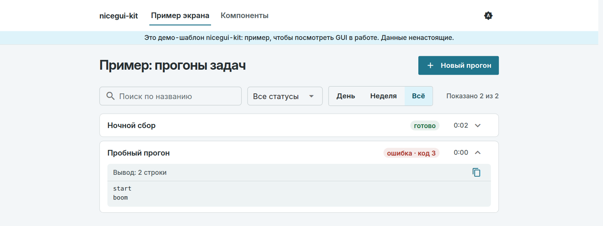
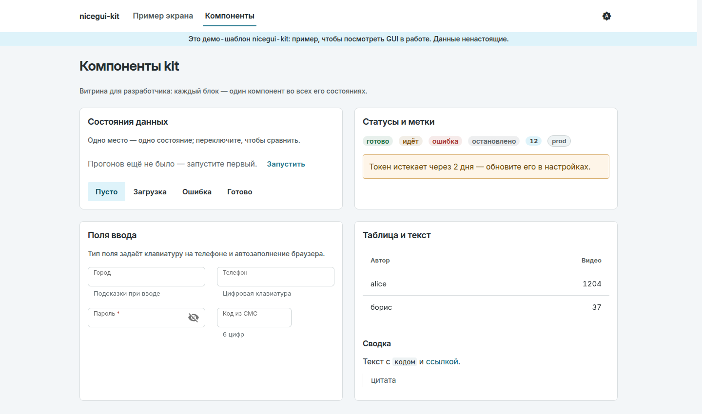

# nicegui-kit

[](https://github.com/octrow/nicegui-kit/actions/workflows/ci.yml)
[](https://pypi.org/project/nicegui-kit/)
[](https://pypi.org/project/nicegui-kit/)
[](LICENSE)

[English](README.md) | **Русский**

Тема и небольшой набор инструментов для приложений на [NiceGUI](https://nicegui.io), которые запускают
задачи: внутренние утилиты, парсеры, админки, очереди на разбор. Один вызов даёт светлую и тёмную тему
с контрастом по WCAG AA, встроенный шрифт Inter (работает без интернета), помощники вёрстки с единым
шагом отступов и пул подпроцессов с живым логом, который переживает перезагрузку страницы и честно
отменяет процесс.

<picture>
  <source media="(prefers-color-scheme: dark)" srcset="docs/images/runs-dark.png">
  
</picture>

Экран выше — это `examples/showcase.py`, около 200 строк поверх кита. Строки кита по умолчанию
русские; `texts.TEXTS.update(texts.EN)` переключает их на английский.

## Что внутри

- Тема: светлые и тёмные токены в одном словаре, каждая пара «текст на фоне» проверена тестами на
  WCAG AA (4.5:1) в обеих темах, кнопка в шапке переключает «как в системе → светлая → тёмная»
  и запоминает выбор.
- Помощники вёрстки: `page_container`, `heading`, `section_card`, `grid`, `field`, `filter_bar`,
  `button` и три состояния, без которых не обходится ни один экран с данными: `empty`, `waiting`,
  `failed`.
- Пул запусков: `run_pool.submit(argv)` запускает подпроцесс с лимитом слотов и очереди, а отмена
  действительно завершает процесс. Кода интерфейса внутри нет, поэтому пул тестируется отдельно.
- Монитор запусков: `run_monitor.attach_run_monitor()` показывает текущие прогоны со статусом, логом
  и кнопкой отмены. Таймер опроса меняет виджеты на месте, а не пересоздаёт их, поэтому раскрытые
  панели, прокрутка лога и фокус не сбиваются.
- Скилл для агента: `.claude/skills/nicegui-kit-gui` учит Claude Code (или другого агента) строить
  экраны на ките.

## Установка

```bash
pip install nicegui-kit
# или
uv add nicegui-kit
```

Python ≥3.12, `nicegui>=3.15,<4`.

## Быстрый старт

```python
from nicegui import ui
from nicegui_kit import layout, run_pool, run_monitor, theme

theme.apply_theme()  # once, before ui.run() — colors/CSS shared across pages


@ui.page("/")
def index() -> None:
    with layout.page_container(max_width=layout.PAGE_MAX_WIDTH_WIDE):
        layout.heading("My tool", level=1)
        theme.theme_toggle()  # usually inside ui.header()
        with layout.section_card():
            layout.button("Run it", kind="primary", on_click=lambda: run_pool.submit(
                ["python", "-c", "print('hi')"], label="demo run",
            ))
        run_monitor.attach_run_monitor()


ui.run(host="127.0.0.1")
```

Полное демо из клона репозитория:

```bash
git clone https://github.com/octrow/nicegui-kit && cd nicegui-kit
uv run python examples/showcase.py   # http://127.0.0.1:8787, ?dark=1 forces dark
```

`/` — пример рабочего экрана (запустите прогон и посмотрите список), `/kit` — галерея компонентов:



## Чем это лучше голого NiceGUI?

NiceGUI даёт компоненты Quasar и классы Tailwind, и для одной страницы этого хватает. Но в нескольких
утилитах подряд одно и то же приходится писать заново: цвета, которые в тёмной теме проваливают
контраст, разные отступы на каждой карточке, подпроцесс по кнопке, который блокирует event loop или
оставляет зомби после закрытия вкладки, лог, который на каждом обновлении прыгает наверх. Кит решает
это один раз и покрывает тестами.

Код на `ui.*` вы по-прежнему пишете сами: кит работает поверх NiceGUI, и каждую его часть можно
взять отдельно. Если вы делаете приложение для данных вокруг датафреймов и графиков, а не задач и
форм, вам, возможно, больше подойдут Streamlit или Gradio.

| модуль | что это |
|---|---|
| `nicegui_kit.theme` | `apply_theme()`: светлые и тёмные токены, типографика, встроенный Inter Variable; `theme_toggle()`, кнопка для шапки |
| `nicegui_kit.layout` | `page_container` / `heading` / `section_card` / `grid` / `field` / `search_field` / `filter_bar` / `actions_row` / `button` / `empty` / `waiting` / `failed` / `markdown_reader` / `copy_for_chat_button` |
| `nicegui_kit.hotkeys` | `on_keydown()`: обёртка над `ui.keyboard`, только нажатие и только без модификаторов |
| `nicegui_kit.table` | `empty_aware_table()`: `ui.table` и надпись «ничего не найдено», синхронизируются одним вызовом |
| `nicegui_kit.texts` | `TEXTS`: все строки кита в одном словаре (по умолчанию русские), `EN` для английского |
| `nicegui_kit.run_pool` | `submit()`: слоты, очередь и жизненный цикл подпроцесса с безопасной отменой, без `ui.*` |
| `nicegui_kit.run_monitor` | `attach_run_monitor()`: живой список прогонов со статусом, логом и кнопкой отмены |

Правила, на которых построена тема (токены, шкала шрифтов, что можно и чего нельзя), описаны в
[DESIGN.md](DESIGN.md) (на английском).

## API

### `theme`

`apply_theme()` вызывает `app.colors(...)` и добавляет в `<head>` один блок `<style>` (через
`ui.add_head_html(..., shared=True)`), поэтому страница не мигает без стилей. Вызывайте его
**один раз и явно**, до `ui.run()`. При импорте он ничего не делает, так что приложение, которому тема
не нужна, за неё не платит.

Цвета лежат в одном словаре на тему, `theme.TOKENS["light" | "dark"]`, и выводятся как переменные
`--ic-<name>` (переключает их `body.body--dark`); отступы и высоты контролов в `theme.SIZES`
(`--ic-s1`…`--ic-s8`, `--ic-h-ctl`, `--ic-h-row`). Брендовые цвета Quasar ссылаются на эти переменные,
поэтому `color=primary` следует теме. Страницы подчиняются `ui.dark_mode` (по умолчанию как в системе);
`theme_toggle()` в шапке переключает «система → светлая → тёмная» и хранит выбор в localStorage.
`theme.TEXT_PAIRS` перечисляет все пары «текст на фоне»; тесты держат каждую на уровне WCAG AA в обеих
темах, так что новый токен добавляется вместе со своей парой.

CSS-классы носят префикс `ic-`, он остался от GUI, из которого кит выделен; переименование только
сломало бы существующие приложения. Классы покрывают цвета статусов
(`ic-status--running/ok/cancel/error/idle`), роли текста (`t-title-page`, `t-title-section`,
`t-status`, `t-meta`, `t-mono`, `t-log`), плашки и карточки ошибок (`ic-banner`, `ic-failure*`),
метки окружения (`ic-chip`, `ic-chip--neutral`, не используются, пока приложение их не рисует) и
поверхность для чтения markdown (`.md-body`). Шрифт лежит в
`nicegui_kit/assets/fonts/InterVariable.woff2` (SIL OFL 1.1, рядом `LICENSE.txt`) и отдаётся по адресу
`/fonts/InterVariable.woff2`; если его нет, используется системный шрифт с кириллицей.

### `layout`

`page_container()`: единственная колонка, в которую каждая страница кладёт содержимое
(`PAGE_MAX_WIDTH_FORM` / `PAGE_MAX_WIDTH_WIDE`). `heading(text, level=1|2|3)`: настоящий тег
`h1`/`h2`/`h3` (по нему ходит скринридер) с подходящей ролью текста. `section_card(recessive=False)`:
карточка с отступами кита. `filter_bar()`: одна строка для фильтров (тема, статус, текст и т. п.),
CSS-соглашение `ic-filters` (одна высота контролов, под 700px они встают друг под другом на всю
ширину). `search_field(placeholder, *, on_change=None)`: поиск для строки фильтров с лупой,
плейсхолдером и aria-label, без плавающей подписи, чтобы совпадать с селектом и переключателем рядом.
Выбранный пункт `ui.toggle` выделяется тональной заливкой (`toggle-color=ic-sel`, ставит
`apply_theme()`), а не второй основной кнопкой. `markdown_reader(text, *, classes="", max_height=None)`:
поверхность `.md-body` с `ui.markdown(text)` внутри; `max_height` (например, `"60vh"`) делает её
прокручиваемой отдельно, в диалоге или боковой панели. `copy_for_chat_button(text)`: кнопка, которая
копирует `text` в буфер обмена и показывает подтверждение.

`button(text, *, kind="normal"|"primary"|"quiet"|"danger", size="ctl"|"row")`: единственный способ
сделать кнопку (одна `primary` на экран, `danger` стоит отдельно). `actions_row()`: кнопки, прижатые
вправо в конце карточки или диалога. `empty(text, action=None)`, `waiting(text)`,
`failed(text, retry=None)`: три состояния любого экрана с данными, везде одинаковые.

`grid(min_col=None)`: сетка на 12 колонок (детям `.classes("ic-span-N")`, под 700px одна колонка) или,
с `min_col="18rem"`, сетка auto-fill. `field(label, *, kind="text", required=False, hint=None,
validation=None, suggestions=None, enter=None)`: текстовое поле кита с правильной клавиатурой на
телефоне и автозаполнением по `kind` (`FIELD_KINDS`), проверкой при потере фокуса и ошибкой, которая
пропадает, как только значение исправлено.

Строки кита по умолчанию русские и лежат в одном словаре: `texts.TEXTS.update(texts.EN)` для
английского или переопределите отдельные ключи. Начертания, интерлиньяж, трекинг, радиусы, тени и
ширины строк тоже токены (`theme.WEIGHTS`, `LEADING`, `TRACKING`, `RADII`, `SHADOWS`, `MEASURES`);
`theme.raw_values(css)` находит объявления в обход них, для теста в вашем приложении.

Шкала шрифтов, анимации и размеры под палец тоже токены: `theme.TYPE_SCALE` (`--ic-fs-*`),
`theme.MOTION` (`--ic-dur-*`, `--ic-ease-*`), `theme.SIZES_COARSE` (крупнее под `pointer: coarse`).
Сводная таблица «2026 baseline» есть в DESIGN.md.

Отступы задают классы кита (`ic-page`, `ic-card`, `ic-stack`, `ic-actions`, `ic-state`, `ic-split`),
а не Tailwind `gap-*` (NiceGUI #2171).

### `hotkeys`

`on_keydown(handler, *, ignore=("input", "select", "textarea"))`: `ui.keyboard`, который вызывает
`handler(event)` только при обычном нажатии (не при отпускании и без зажатого Ctrl). Эти две проверки
нужны любой горячей клавише уровня страницы до её собственной логики. `passes(event) -> bool` и есть
эта проверка, вынесенная в чистую функцию, чтобы её можно было тестировать без живой страницы.

### `table`

`empty_aware_table(columns, *, row_key, pagination=None, empty_text=...) -> EmptyAwareTable`:
`ui.table` и надпись, которая заменяет таблицу, когда ничего не найдено. Вызывайте `.set_rows(rows)` из
функции обновления фильтра: она передаёт новые строки и переключает видимость таблицы и надписи.
Подходит только для таблицы, которую строят один раз и меняют на месте при каждом изменении фильтра;
таблице, которую каждый раз строят заново (например, внутри `@ui.refreshable`), это не нужно.

### `run_pool`

Пул подпроцессов с безопасной отменой: `MAX_PARALLEL_RUNS` слотов, очередь до `MAX_TOTAL_PENDING`,
история на `FINISHED_HISTORY_LIMIT`. `submit(argv, *, label="", cwd=None, env=None, meta=None,
on_line=None, spawn=None) -> RunState | None` (`None` значит, что очередь полна). `argv` — полная
командная строка (программа и аргументы): что и где запускать, решает вызывающий код. `on_line`
вызывается на каждую строку объединённого stdout+stderr (не из slot-стека NiceGUI; почему там нельзя
трогать `ui.*`, объясняет docstring модуля). `request_cancel(run_id)`,
`async terminate_all_live_processes(grace_seconds=0.0)` (регистрируйте его в `app.on_shutdown` через
обёртку без аргументов, `async def _stop(): await run_pool.terminate_all_live_processes()`, потому что
NiceGUI передаёт `App` в обработчик с одним параметром и он попал бы в `grace_seconds`;
`grace_seconds` — сколько ждать дочерние процессы после SIGTERM), `live_runs()` (в очереди и
запущенные), `all_runs()`.

У каждого `RunState` есть `label: str` (его показывает интерфейс) и `meta: dict` (всё, что приложение
хочет сохранить и прочитать потом, например для своей проверки на повторный запуск).

### `run_monitor`

`attach_run_monitor(*, run_filter=None, idle_text=..., poll_interval_seconds=1.0, log_max_lines=2000,
error_tail_lines=15)`: живой список прогонов из пула со строкой статуса, живым логом (`ui.log`),
кнопкой отмены с подтверждением и, для упавших прогонов, кнопкой «Скопировать для чата» (сводка и
последние строки лога). Статус показан один раз, цветом, в заголовке прогона, и виден даже в свёрнутом
виде; лог — единственное место с выводом. Главный инвариант: таймер опроса **никогда** не пересоздаёт
виджеты существующего прогона, только меняет их (в NiceGUI нет виртуального DOM, и пересоздание
сбрасывает раскрытые панели, прокрутку лога и фокус).

## Вне рамок

Предметная логика остаётся в вашем приложении. Кит даёт детали, из которых её можно собрать:

- Проверку на повторный запуск и текст вида «вы N-й в очереди» стройте на `RunState.meta` и
  `run_pool.live_runs()`.
- Разбор вывода на известные ошибки: сводка об ошибке — это простая строка «код N»; если нужно больше,
  читайте лог в `on_line`.

## Скилл для агента

`.claude/skills/nicegui-kit-gui/SKILL.md` учит агента строить GUI на этом ките (что брать за образец и
какие неочевидные ловушки есть в NiceGUI). Claude Code подхватывает его сам в сессиях внутри этого
репозитория; чтобы пользоваться им в своих проектах, установите его:

```bash
# via the skills CLI (https://github.com/vercel-labs/skills); copies the skill, works with several agents
npx skills add octrow/nicegui-kit --skill nicegui-kit-gui -g -a claude-code   # global
npx skills add octrow/nicegui-kit --skill nicegui-kit-gui -a claude-code      # into ./.claude/skills of the current project
```

Обновить: `npx skills update nicegui-kit-gui`, удалить: `npx skills remove nicegui-kit-gui`.

## Разработка

```bash
uv sync --extra dev
uv run pytest -q
```

Помощь приветствуется, см. [CONTRIBUTING.ru.md](CONTRIBUTING.ru.md). Уязвимости: [SECURITY.ru.md](SECURITY.ru.md).

## Лицензия

MIT, см. [LICENSE](LICENSE). Встроенный шрифт Inter распространяется по SIL Open Font License 1.1, см.
[THIRD_PARTY_NOTICES.md](THIRD_PARTY_NOTICES.md).
