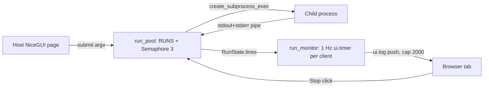

# System design review: nicegui-kit

Library (Python package `nicegui_kit`, ~1.9k LOC in `src/`), no server of its own, no DB, no cache. It runs inside a host NiceGUI app (single process, single event loop). Flow details: [logic-map.md](logic-map.md). Known fixes in progress: `docs/plans/2026-11-05-logic-map-fixes.md`. Steps 3 (API) and the cache part of 5 are n/a.

## Assumptions

| Item | Value | Label |
|---|---|---|
| Users per host app | 1 (owner), up to ~5 browser tabs | assumed (personal tools) |
| Runs/day | ~50 subprocess runs | assumed |
| Parallel slots | 3 (`MAX_PARALLEL_RUNS`, run_pool.py:33) | measured (code) |
| Pending cap / finished history | 20 / 20 (run_pool.py:34-35) | measured (code) |
| Monitor poll | 1.0 s per page client (run_monitor.py:20) | measured (code) |
| DOM log cap | 2000 lines (run_monitor.py:18) | measured (code) |
| Memory per stored 100-char line | ~149 B | measured (python3 sys.getsizeof, local) |
| Lines per run | 100 typical, 1M chatty worst case | assumed |
| Repo activity | 28 commits, last 2026-11-05 | measured (git log) |

## 0. What exists

Stack, entry points, flow: see logic-map.md. State is one process-global dict `RUNS` plus an asyncio semaphore; no persistence, no logs on disk, no deploy of its own. Rung today: 1 (single process, in-memory state). It sits inside the host app's rung.

## 1. Requirements

One sentence: let a NiceGUI page start CLI subprocesses with bounded parallelism, stream their output live, and stop them.
- Functional: submit run, queue/FIFO, stream lines, cancel, show list with status; plus theme/layout/table/hotkey helpers.
- Out of scope: persistence across restarts, multi-user auth, multi-process hosts, process groups, resource limits.
- NFRs: scale 1 user; latency: line to screen within ~1 s (poll interval); availability: dies with the host app; durability: none (runs and logs are lost on restart, acceptable); consistency: single event loop, no locks needed; security: argv passed as list (no shell), env inherited by default; observability: `logger.exception` on callback failure only.

## 2. Napkin math

Traffic is trivial, so the interesting numbers are memory and tick cost, not RPS.

```
$ napkin.py --dau 1 --req-per-user 500 --peak 3 --server-rps 50
requests/day 500, peak 0.0 req/s
servers @ 50 req/s: 2 (1 + spare); DB shards 1, replicas 0
storage per year 109.5MB (x3 repl)
verdict: rungs 1-2: one good VPS. Ship it.
```

Derived (python3, assumed inputs, measured per-line size):
```
1 chatty run, 1M lines x 149 B = 149 MB
23 runs retained x 1M lines   = 3.4 GB   (pending 20 is the cap on queued+running; up to 20 more finished are kept)
monitor: 23 rows x 5 tabs     = 115 row updates/s at 1 Hz
```
Realistic case (100 lines/run): 23 x 100 x 149 B = ~0.3 MB, negligible.

## 3. API contract

n/a (library). Public surface is in [api.md](api.md): `run_pool.submit/request_cancel/terminate_all_live_processes`, `run_monitor.attach_run_monitor`, `theme`, `layout`, `table`, `hotkeys`.

## 4. Architecture


Boxes: the pool exists because parallelism must be bounded (3 slots); the monitor polls instead of pushing so background tasks never touch `ui.*` (logic-map, "Nothing in steps 1-7 touches ui"). No queue, DB or cache box: nothing needs them at 1 user.

## 5. Data

In-memory only: `RUNS: dict[run_id, RunState]`, `RunState.lines: list[str]` uncapped (run_pool.py:155) while the DOM log is capped at 2000. Retention is bounded by count (20 finished) but not by size. No cache; the browser holds theme and hidden columns in localStorage (restore limits: logic-map #6). Persistence option if ever needed: append lines to a file per run (rung-neutral), not a DB.

## 6. Scale and failure

- x10 load (10x lines/s or 10x tabs): the first thing to saturate is event-loop time in the 1 Hz tick: each tick touches every row and pushes new lines one at a time (logic-map step 8, #10), so cost is ~ rows x tabs per second (115/s now, 1150/s at x10) plus the single-line `ui.log.push`. A process printing 100k lines/s starves the loop before memory matters. Next rung: batch pushes per tick and cap `lines` (ring buffer or spill to disk); trigger: tick duration > 250 ms or host p95 UI latency > 500 ms.
- Memory: uncapped `lines` is the second limit: 1M-line runs cost 149 MB each; trigger: RSS of host > 500 MB.
- Slow/hung child: ignores SIGTERM and keeps its slot forever (#3); 3 such children block the whole pool, queue fills to 20, `submit` returns `None`. No timeout, no SIGKILL escalation.
- Grandchildren hold the pipe: run stays `running`, Stop does nothing (#9).
- Host process dies / restart: all runs, logs and queue lost; children may be orphaned unless `terminate_all_live_processes` ran on shutdown (direct children only).
- Retries/backoff, rate limits, circuit breakers, backups: n/a. A caller-side retry is the host's job.
- Single VM loss: same as the host app; no state to restore.

## 7. Trade-offs

- Polling (1 Hz) vs push: simple and slot-safe, costs up to 1 s latency and O(rows x tabs) work per second.
- In-memory vs persistent: no disk, no schema; costs durability and unbounded RAM per run.
- Global singleton pool vs instance: trivial API; costs test isolation (`reset_pool_for_tests`) and one pool per process.
- Direct-child SIGTERM vs process groups: portable and simple; costs orphan grandchildren.
- Fixed constants at import: simple; slot count changes only via the test hook (api: entry table in logic-map).

## 8. Summary

- Three lines: one in-process asyncio pool (3 slots, 20 pending), 1 Hz poll monitor, no persistence. Correct for one user on one box.
- Would change if wrong: runs with >100k lines or log-heavy children (cap/spill `lines`); more than a few tabs (batch ticks); untrusted or flaky children (SIGKILL escalation, process groups, timeout); multi-worker hosts (pool is per process, state not shared).
- Next rung: per-run log spill to disk plus a line cap, when RSS > 500 MB or tick > 250 ms. Beyond that a real job queue (separate worker) only if runs must survive host restarts.

## Risks

- MEDIUM: `RunState.lines` never capped; a chatty child grows RAM unboundedly (149 MB per 1M lines, ~3.4 GB at 23 retained runs). `src/nicegui_kit/run_pool.py:155`
- MEDIUM: no SIGKILL escalation or run timeout; a child ignoring SIGTERM holds a slot, 3 of them freeze the pool (logic-map #3). `src/nicegui_kit/run_pool.py` (step 6/7)
- MEDIUM: grandchild holding stdout keeps run `running` and un-stoppable; cancel/shutdown hit direct child only (#9). `src/nicegui_kit/run_pool.py` (step 7/9)
- MEDIUM: a `spawn` failure leaves a permanent `queued` run counting toward the 20 cap (#1). `src/nicegui_kit/run_pool.py:126`
- LOW: tick pushes lines one at a time per row per tab, O(rows x tabs) per second; fine at 1 user, first to saturate at x10. `src/nicegui_kit/run_monitor.py:176`
- LOW: a raising `run_filter` aborts the tick for later rows and deletion (#5). `src/nicegui_kit/run_monitor.py`
- LOW: no persistence: runs and logs vanish on host restart. `src/nicegui_kit/run_pool.py` (`RUNS`)
